# Agrovantis Precision

Plataforma de agricultura de precisão para agrônomos e consultorias, com extensão para o produtor.

## Estado atual: Build 004

- Autenticação e dados em nuvem no Supabase.
- Consultorias, clientes, propriedades e talhões.
- Importação de limites KML e mapas com Leaflet.
- Campanhas de amostragem de solo, pontos e registro de coleta.
- Exportação de dados e CSV de amostragem.

Veja [docs/build004.md](docs/build004.md) para escopo e limitações. A homologação visual completa permanece pendente. Este repositório contém a versão recuperada do código salvo; não representa uma Build 005 concluída.

## Executar localmente

Requer Python 3:

```bash
python -m http.server 5173 --directory dist
```

Abra http://localhost:5173 no navegador. A aplicação depende de conexão com o Supabase e com os provedores de mapas.

## Configuração

A URL do projeto e a chave **publicável** estão em `dist/cloud.js`. Essa chave faz parte do cliente web; o acesso aos dados depende das políticas RLS do banco e da sessão do usuário. Nunca inclua senhas, tokens de sessão ou chaves administrativas (`service_role` / `sb_secret_`) no frontend.

As migrações do banco ainda não estão incluídas nesta exportação. Portanto, o código sozinho não provisiona um novo banco. O projeto Supabase existente é necessário para o funcionamento atual.

## Organização

- `dist/`: aplicação HTML, CSS e JavaScript, sem etapa de build.
- `dist/vendor/leaflet/`: biblioteca Leaflet e sua licença.
- `docs/`: documentação das entregas.
- `.openai/hosting.json`: configuração do Site original.

O envio ao GitHub não configura deploy automático nem altera a publicação existente.

## Fazenda modelo e capturas

[Abrir demonstração preenchida](https://agrovantis-precision.fdaalves.chatgpt.site/demo.html)

A demonstração não exige login no aplicativo e não acessa o Supabase; o Site mantém seu controle de acesso existente. Inclui um produtor fictício, uma propriedade, três talhões (aproximadamente 182 ha), três campanhas e 24 pontos. Edições duram somente até recarregar a página. Limites e pontos são ilustrativos e não representam recomendações agronômicas. Resultados laboratoriais e prescrições ainda não estão implementados.

### Talhões e mapa

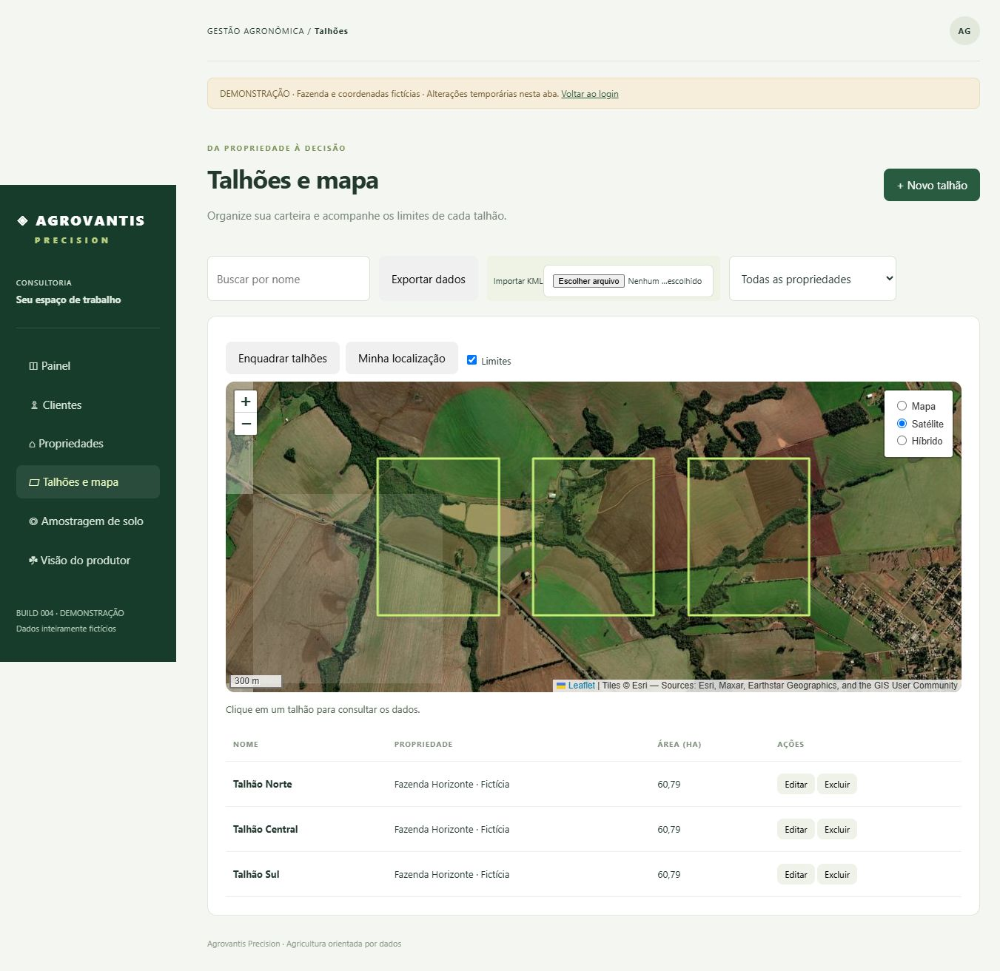

### Amostragem de solo

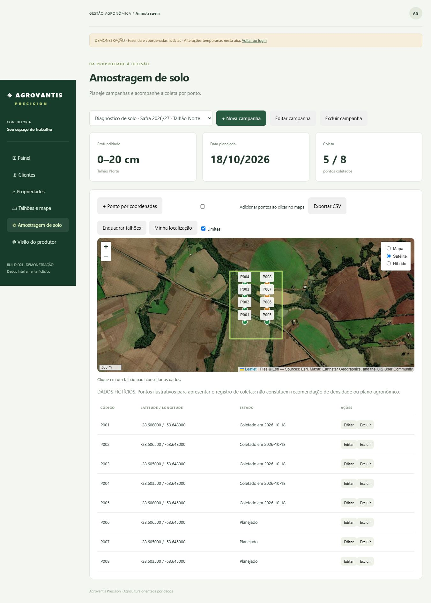

### Outras telas da demonstração

#### Visão geral

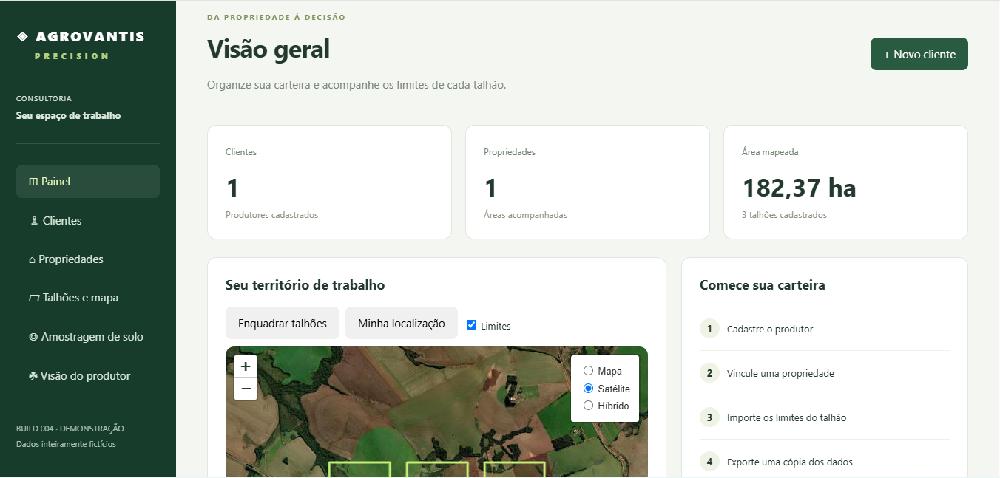

#### Mapa no painel

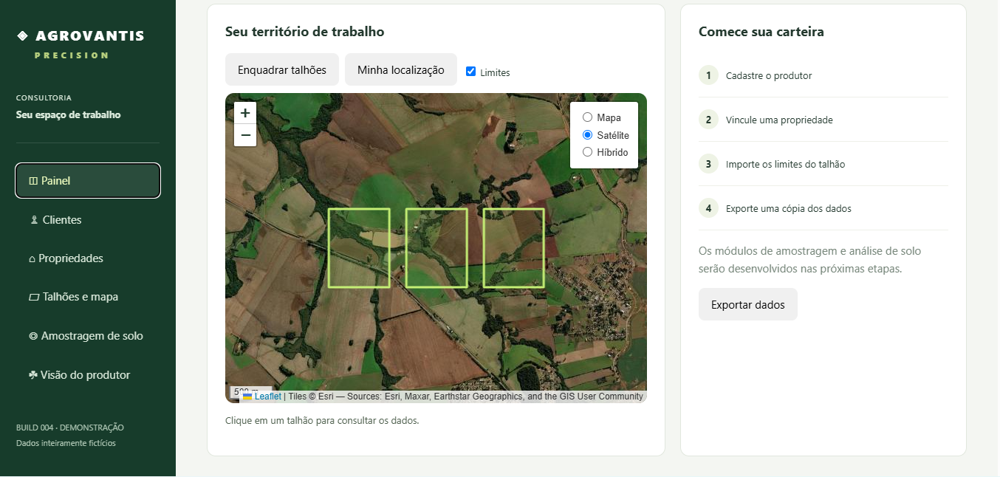

#### Clientes

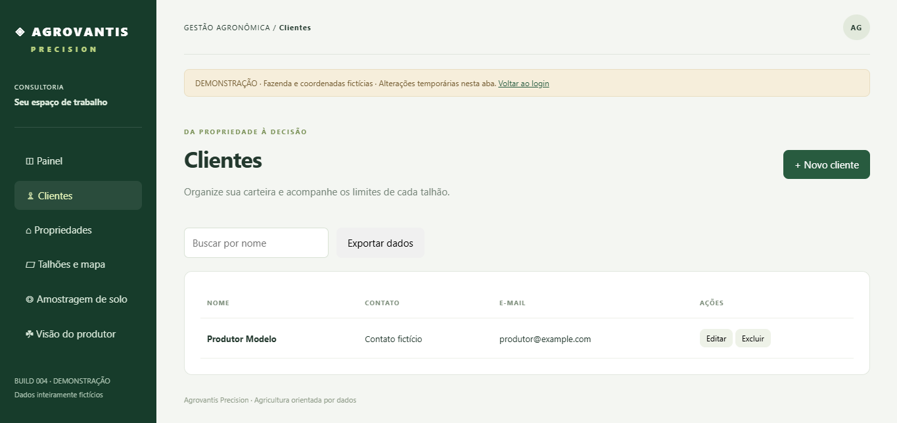

#### Propriedades


### Detalhes dos talhões e da amostragem

#### Talhões em imagem de satélite

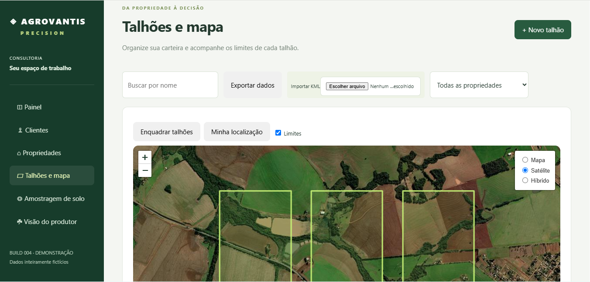

#### Lista de talhões e áreas

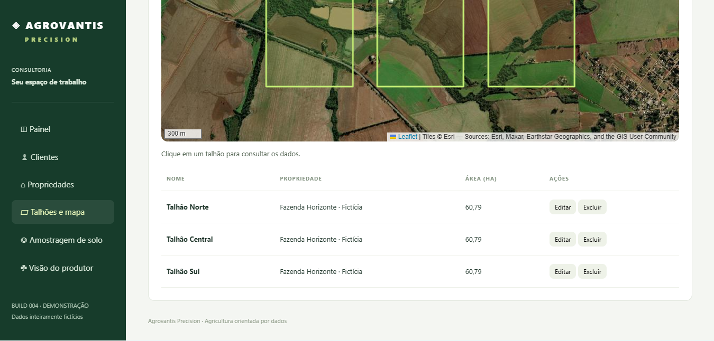

#### Resumo da campanha de amostragem

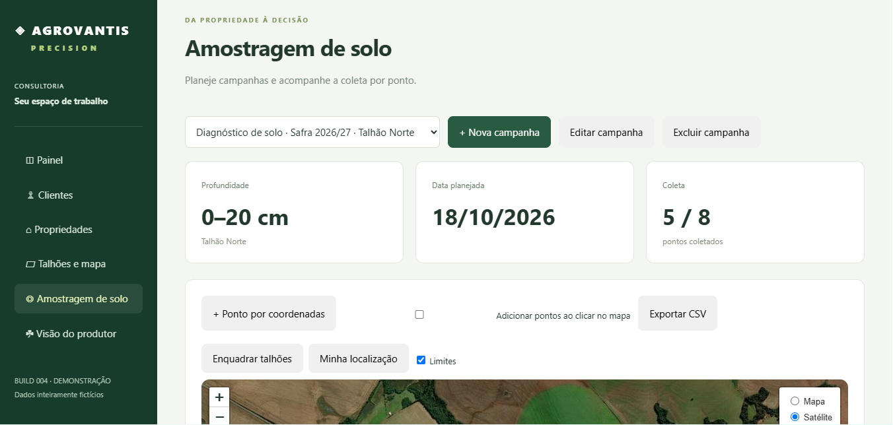

#### Pontos de coleta no mapa

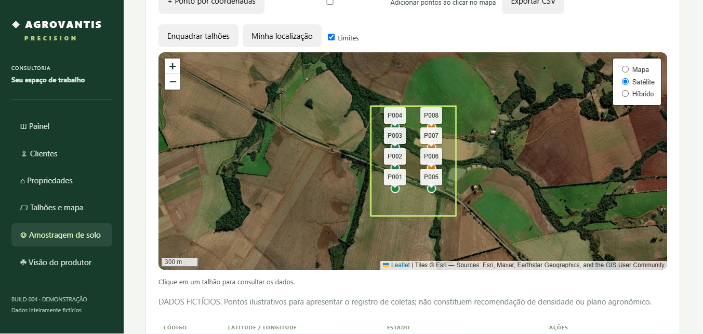

#### Lista e situação das amostras

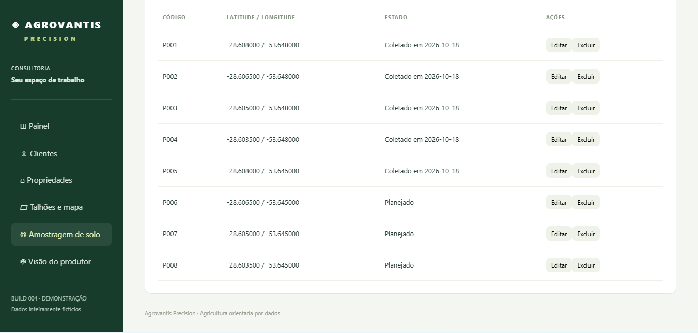

#### Prévia do portal do produtor

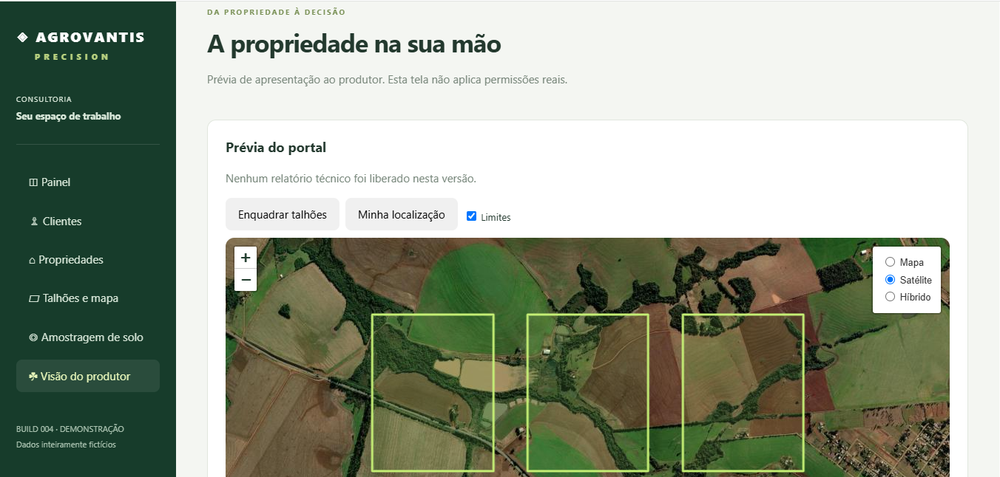

O portal do produtor exibido é uma prévia: ainda não apresenta relatórios técnicos liberados nem comprova autorização entre usuários.
